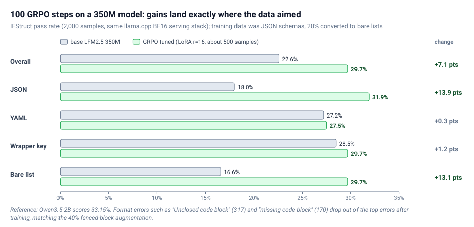

Reading notes on:
- [How frontier models train on outcomes in 2026](https://huggingface.co/blog/sergiopaniego/agentic-rl-2026)
- [Fine-tuning a 350M Model for Better Structured Outputs in 100 GRPO Steps](https://huggingface.co/blog/grpo-with-trl-ifstruct)

This is step 3 of the Hugging Face **Training Agents** curriculum (hub: [A Curriculum for Post-Training Agents]()). [Distillation]() needed a teacher. RL needs only a way to **check the answer**. The model writes an answer, a reward function scores it, and training makes high-scoring answers more likely.

The curriculum's framing of the step:

- **Algorithm:** GRPO (Group Relative Policy Optimization). For each prompt it samples several answers, scores them all, and raises the probability of those that scored above the group average. Comparing within the group says which attempts were better without training a separate value model.
- **Cost:** the signal is weaker than distillation's, one number for the whole answer instead of one per token, so the model needs many attempts.
- **Limit:** with a plain reward function each answer is a single turn, scored once. Environments, the next step, let the model act several times and see the result of each action.

The two posts pair a survey of what frontier reports say about RL with a small, fully reproducible GRPO run on a 350M model.

---

## 1. How RL in Post-Training Got Here

The first wave was **RLHF** (InstructGPT). A reward model learned human preferences, and PPO trained against it with fresh samples at every step. DPO later removed the sampling loop and learned from fixed preference pairs. The wave this survey covers is the next one, where **the reward stopped being a preference and became a result**:

- **OpenAI o1** (September 2024) put RL at the center of reasoning: "Our large-scale reinforcement learning algorithm teaches the model how to think productively using its chain of thought", with performance that "consistently improves with more reinforcement learning (train-time compute) and with more time spent thinking (test-time compute)". No algorithm details.
- **Tulu 3** gave the open community the term **RLVR**, Reinforcement Learning with Verifiable Rewards. The reward is a check you can execute, not a learned preference model.
- **[DeepSeek-R1]()** (January 2025) showed it in the open: "the reasoning abilities of LLMs can be incentivized through pure reinforcement learning", including the "aha moment" where the model "naturally learns to solve reasoning tasks with more thinking time". R1 trains with GRPO, which comes from the earlier DeepSeekMath paper.
- **Llama 4** already treated online RL as the core of its pipeline, alternating between training the model and using it to "continually filter and retain only medium-to-hard difficulty prompts".

On how far RLVR alone can push reasoning, see [Reasoning Limits of LLMs Under RLVR]() and [Predictable Scaling of RL for LLMs]().

---

## 2. Rewards You Can Execute

The class rewarded code by running its tests. The same pattern runs from 7B models to frontier systems:

- **Qwen3** describes its Reasoning RL stage as GRPO over curated "query-verifier pairs". Every prompt carries its own check.
- **MiMo-7B** curated "130K verifiable mathematics and programming problems" and added "a test-difficulty-driven code-reward scheme to alleviate sparse-reward issues". A pass/fail reward carries little information. Weighting tests by difficulty makes each attempt more informative.
- **Magistral**: "We limit ourselves to problems with verifiable solutions", numerical math answers and code with tests.
- **Gemma 3** lists "code execution feedback" and "ground-truth rewards for solving math problems" in its RL phase.
- **[Kimi K2]()** uses a self-critic for everything a check cannot reach, but the critic is anchored to the verifiable side. "On-policy rollouts generated from verifiable-reward prompts are used to continuously update the critic". Even the model-based reward is trained on checks you can execute.
- **[GLM-5]()** combines "rule-based reward functions, outcome reward models (ORMs), and generative reward models (GRMs)" in one hybrid system.

The class summarized it in one line: **if you can execute a check, you have a reward function.**

---

## 3. GRPO Became a Family

Among labs that describe their algorithm, **GRPO is the usual starting point, and almost everyone changes something.**

![GRPO family tree: original GRPO (group-relative advantage, from DeepSeekMath) at the center, with five descendants and the one change each makes. DAPO: clip-higher, dynamic sampling, token-level loss, overlong reward shaping. Dr. GRPO: removes the length bias that inflates incorrect outputs. GSPO: sequence-level importance ratio and clipping. CISPO: clips importance-sampling weights instead of token updates. Magistral: drops zero-advantage groups from the batch. A footer notes that TRL GRPOTrainer now defaults loss_type to dapo](/assets/images/grpo_family_tree.svg)

For reference (my addition; the survey deliberately does not re-derive GRPO), the GRPO advantage for response $i$ in a group of $G$ samples is the reward standardized within the group:

$$
\hat{A}_i = \frac{r_i - \operatorname{mean}(r_1, \dots, r_G)}{\operatorname{std}(r_1, \dots, r_G)}.
$$

Each variant changes one piece of the surrounding objective:

| Variant | What it changes, in the paper's words |
| --- | --- |
| **[DAPO]()** | "1. Clip-Higher, which promotes the diversity of the system and avoids entropy collapse; 2. Dynamic Sampling, which improves training efficiency and stability; 3. Token-Level Policy Gradient Loss, which is critical in long-CoT RL scenarios; 4. Overlong Reward Shaping, which reduces reward noise" |
| **Dr. GRPO** | fixes "an optimization bias in Group Relative Policy Optimization (GRPO), which artificially increases response length (especially for incorrect outputs)" |
| **GSPO** | "defines the importance ratio based on sequence likelihood and performs sequence-level clipping, rewarding, and optimization", credited with improvements in the latest Qwen3 models |
| **CISPO** | "clips importance sampling weights rather than token updates" |
| **Magistral** | "filter out all groups with zero advantage when forming training batches" |

Magistral's rule maps straight onto a dashboard metric. A group where every sample gets the same reward has zero advantage and teaches nothing. In TRL that is `frac_reward_zero_std`, and here it is a training rule at a frontier lab.

You can see the evolution in **TRL's own defaults**. As of August 2026, `GRPOTrainer`'s `loss_type` defaults to `"dapo"`, not the original GRPO loss. The docstring for `"grpo"` says it is "Not recommended due to length bias", because it "tends to prefer shorter completions with positive advantages and longer ones with negative advantages". GSPO is one flag away: `importance_sampling_level="sequence"`. For stability fixes beyond these, see [First-Order Approximation for Stable LLM-RL]().

The class ran three experiments at 0.6B: a toy reward, a verifiable reward, and a reward broken on purpose. In the broken run, the Trackio dashboard said training was going great while the model got worse at coding. Entropy collapse, the problem DAPO's Clip-Higher exists to avoid, is visible in that run. The author draws a careful distinction here. Dr. GRPO fixes a length bias that comes from the **objective**. The broken run grew long for a simpler reason, because its reward **paid** it to produce more. The curves look alike, but the cause and the fix differ.

---

## 4. The Reward Is Becoming an Environment, and Then a Teacher

Two trends point to the next steps of the curriculum.

**From answers to environments.** The newest reports have the model act (open files, run commands, use tools), with the reward arriving at the end based on what happened. Liquid AI on LFM2.5-2.6B: "Each rollout runs in a dedicated sandbox with its own runtime. We optimize with GRPO, using an outcome-based reward that combines an LLM-as-a-judge rubric, programmatic checks, and a hard safety gate." Cursor's Composer, [Kimi K3](), GLM-5, Nemotron 3 Ultra and [MiniMax]() describe versions of the same idea. That is [step 4]().

**RL then distillation.** Labs use RL to build a capability in specialists, then distillation to bring it into one model. DeepSeek-V4 trains experts with GRPO and merges them with on-policy reverse-KL distillation. In MiMo-V2-Flash the RL lives in the **teachers**, which "provide dense and token-level reward" to the student. LFM2.5-2.6B runs the same two-step at small scale before its own agentic RL stage.

### All the reports at a glance

| Pattern | Plain meaning | Examples |
| --- | --- | --- |
| The lineage | preference rewards to verifiable results | InstructGPT, o1, Tulu 3, DeepSeek-R1, Llama 4 |
| Verifiable rewards | run a check on the result | Qwen3, MiMo-7B, Gemma 3, Magistral, Seed1.5-Thinking |
| Hybrid rewards | checks plus model-based judges | Kimi K2, GLM-5, LFM2.5-2.6B |
| Modified GRPO | fix stability, length or sampling | DAPO, Dr. GRPO, GSPO, CISPO, Magistral |
| Agentic RL in environments | tools and multi-step interaction | Kimi K3, GLM-5, Nemotron 3 Ultra, MiniMax (Forge), Cursor, LFM2.5-2.6B |
| RL then distillation | improve specialists, transfer to one model | DeepSeek-V4, MiMo-V2-Flash, LFM2.5-2.6B |

The survey's scope note: this covers public training descriptions as of August 2026. Gemma 4 is excluded because its report does not describe post-training. Anthropic and Cohere were not investigated, and OpenAI appears only through its o1 post.

---

## 5. A Worked Example: 350M Parameters, 500 Samples, 100 Steps

The curriculum's project for this step is a recipe for making a small model better at **structured-output compliance**: does it return valid, parseable output in the requested format and shape? It fine-tunes **LFM2.5-350M** with GRPO in TRL and evaluates on **IFStruct** (2,000 test samples, JSON and YAML, wrapper-key and bare-list structures). The run uses about 500 samples and 100 steps, small enough for a free-tier Colab or Kaggle GPU.

### Baseline

Served locally with `llama.cpp` (BF16 GGUF) on a MacBook, the base model scores **22.6%** (452/2000), close to the 21.1% in the IFStruct release. The dominant error is "required field missing" (7,228 occurrences), followed by wrong item count (738) and type mismatch (540).

### Data

`nvidia/Nemotron-RL-instruction_following-structured_outputs` pairs each prompt with a target JSON Schema and an expected field count. About 500 samples are used, augmented to close two gaps with IFStruct:

- **40%** get a "return the output inside a fenced code block" instruction, so the model follows the format instruction instead of always emitting raw JSON.
- A disjoint **20%** become top-level-array tasks (schema wrapped in an `array` with a required item count), which trains bare-list output and item-count compliance.

### Model and rewards

LoRA with `r=16`, `lora_alpha=32`, targeting the hybrid attention/convolution module names (`q_proj`, `k_proj`, `v_proj`, `out_proj`, `in_proj`, `w1`, `w2`, `w3`). That is about **6M trainable parameters, 1.66% of the model**.

Three rewards, each on $[0,1]$, combined as a weighted sum with `reward_weights=[1.0, 0.5, 2.0]`:

| Reward | Scores | Partial credit |
| --- | --- | --- |
| `json_format_reward` (weight 1.0) | parseable, and in the requested form? | 1.0 requested form, 0.2 wrong-but-parseable form, 0.0 unparseable |
| `field_count_reward` (weight 0.5) | expected number of top-level fields? | 1.0 exact, decays linearly with the miss |
| `schema_validation_reward` (weight 2.0) | validates against the row's JSON Schema? | counts violations, gated on required-key coverage |

### Training config

`learning_rate=5e-5`, `max_steps=100`, `warmup_steps=10`, `num_generations=8`, `per_device_train_batch_size=4`, `gradient_accumulation_steps=8` (4 prompt groups per optimizer step), `steps_per_generation=2`, `max_completion_length=1024`, `temperature=1.1` ("hotter sampling keeps groups varied"), `beta=0.01` KL penalty. Over the run, all three reward components climb, the KL lifts off zero after warmup, and the truncated-completion fraction stays near zero. The LoRA is then merged and converted back to GGUF for the same serving stack.

### Result

| IFStruct group | base | GRPO-tuned | Δ |
| --- | --- | --- | --- |
| Overall | 22.6% | 29.7% | +7.1 |
| JSON | 18.0% | 31.9% | +13.9 |
| YAML | 27.2% | 27.5% | +0.3 |
| Wrapper key | 28.5% | 29.7% | +1.2 |
| Bare list | 16.6% | 29.7% | +13.1 |

**The gains land exactly where the training aimed.** The data was JSON-schema prompts with 20% converted to bare lists. JSON rises 13.9 points and bare list rises 13.1, while YAML barely moves. The tuned 350M model is still below Qwen3.5-2B's 33.15%, but light task-specific RL closes much of the gap to a model several times larger. The error profile shifts too: "Unclosed code block" (317) and "missing code block" (170) drop out of the top errors entirely, which is the fenced-block augmentation doing its job.

---

## Takeaways

1. **If you can execute a check, you have a reward.** Verifiable rewards are the center of 2026 RL, and even learned critics (Kimi K2) are trained against them.
2. **Nobody runs vanilla GRPO.** DAPO, Dr. GRPO, GSPO, CISPO and Magistral each change one piece. TRL's default loss is now `"dapo"`.
3. **Zero-variance groups are dead weight.** Magistral filters them, and TRL exposes them as `frac_reward_zero_std`.
4. **A reward that pays for length looks like a length bias but is not one.** Diagnose the cause before applying the fix.
5. **Small RL runs move exactly what the reward and data target.** IFStruct's +13.9 on JSON and +0.3 on YAML show it.
