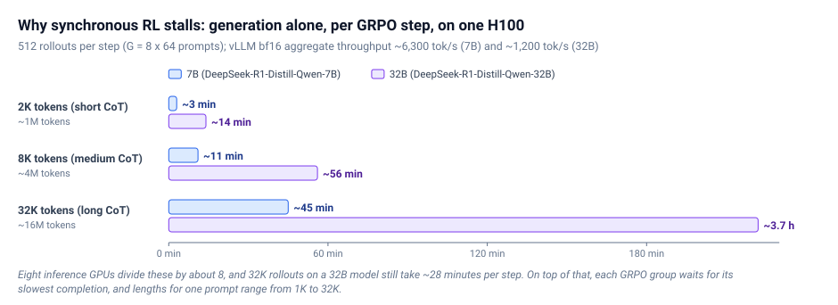

Reading notes on:
- [Keep the Tokens Flowing: Lessons from 16 Open-Source RL Libraries](https://huggingface.co/blog/async-rl-training-landscape)

This post belongs to step 5 of the Hugging Face **Training Agents** curriculum, "harnesses and scale" (hub: [A Curriculum for Post-Training Agents]()). Once rollouts become full agent runs, generation and training can no longer take turns. The curriculum's one-line answer is that **generation and training run on separate GPUs**, so long episodes do not leave the trainer idle, and the trainer sends updated weights back to vLLM. This survey from the TRL team is the long version of that sentence. They studied 16 libraries to design TRL's async trainer (now `AsyncGRPOTrainer`).

The TL;DR in three lines:

- **Problem.** In synchronous RL, generation dominates wall-clock time. One batch of 32K-token rollouts on a 32B model can take hours while the training GPUs sit idle.
- **Convergent solution.** Disaggregate inference and training onto separate GPU pools, connect them with a rollout buffer, and push weights asynchronously, so neither side waits.
- **Findings.** Ray dominates orchestration (8 of 16). NCCL broadcast is the default weight transport. Staleness handling ranges from dropping old samples to importance-sampling correction. LoRA support is sparse. Distributed MoE support is the emerging differentiator.

I have covered pieces of this before: [StreamRL](), a roundup of [RL infra papers](), and SemiAnalysis's [RL Systems Mind the Gap]() on matching trainer and generator throughput. This survey is the most complete map of the open-source design space I have seen.

---

## 1. Why Synchronous RL Stops Scaling

### What a synchronous step looks like

TRL's original `GRPOTrainer` runs the whole GRPO loop in one blocking `training_step()`: sample prompts, generate $G$ completions per prompt, score rewards, compute advantages, forward/backward, optimizer step, push weights to vLLM. Each phase waits for the previous one. `steps_per_generation` reuses one rollout batch across several gradient steps, but the generation call itself still blocks. vLLM `server` mode frees the training GPU during generation, but two hard barriers remain: waiting for every HTTP completion, and a weight sync that blocks both sides.

### Colocated versus disaggregated

- **Colocated:** inference and training share GPUs and take turns. Weight "sync" is at most an in-place reshard. It needs fewer GPUs, but **inference and training can never overlap**.
- **Disaggregated:** separate pools, each running continuously, joined by a weight-sync protocol and a data transport. While the trainer works on batch $N$, the inference pool generates batch $N+K$. It costs more GPUs.

The survey uses "async" in a narrow sense: generation and training running **at the same time**. That requires disaggregation, and every library in the survey that achieves meaningful overlap is built on it.

![Synchronous versus asynchronous RL timelines. Top: in a synchronous colocated loop, generation, scoring, train and weight-sync phases alternate on the same GPUs, and the trainer idles during generation, with the slowest rollout in each GRPO group gating the step. Bottom: in a disaggregated asynchronous loop, the inference pool generates continuously into a bounded rollout buffer tagged with policy versions, the trainer pulls batches continuously, and weights flow back by NCCL broadcast. The cost is staleness: rollouts arrive from a policy one or more versions old](/assets/images/async_rl_timeline.svg)

### The generation bottleneck, in numbers

On one H100 (vLLM, bf16, offline throughput), a 7B model (DeepSeek-R1-Distill-Qwen-7B) pushes about **6,300 output tokens/s** in aggregate, and a 32B model about **1,200 tokens/s**. A typical GRPO step of $G=8 \times 64$ prompts $= 512$ rollouts then costs:

| Output length per rollout | Total output tokens | 1×H100, 7B (~6K tok/s) | 1×H100, 32B (~1.2K tok/s) |
| --- | --- | --- | --- |
| 2K (short CoT) | ~1M | ~3 min | ~14 min |
| 8K (medium CoT) | ~4M | ~11 min | ~56 min |
| 32K (long CoT) | ~16M | ~45 min | ~3.7 hours |

Eight inference GPUs divide this by about 8, and 32K rollouts on a 32B model still take about 28 minutes per step. Then the **straggler problem** compounds it. A GRPO group cannot be scored until its slowest completion finishes, and CoT lengths for one prompt can range from 1K to 32K tokens. Continuous batching frees slots for new work, but the last sequence in a group still blocks that group's reward and update.

Three trends make this worse: long reasoning rollouts, critic-free group methods that generate $G$ times more samples, and agentic RL with highly variable tool latencies. MiniMax's Forge, used for MiniMax-M2.5, runs up to 200K-token contexts across over a hundred thousand distinct scaffolds and environments, with millions of samples a day. At that scale any synchronous barrier idles hundreds of GPUs.

**The core insight every library converged on:** physically separate inference from training, push weights asynchronously, and let a buffer decouple the two loops. That buys throughput and introduces new problems: staleness, sync overhead, and partial rollouts. The seven axes below are how libraries handle them.

---

## 2. The 16 Libraries

AReaL (inclusionAI/Ant Group), ART (CoreWeave), Atropos (NousResearch), MILES (radixark), NeMo-RL (NVIDIA), OAT (SAIL-SG), open-instruct (AI2), PipelineRL (ServiceNow), PRIME-RL (PrimeIntellect), ROLL (Alibaba), SkyRL (NovaSky-AI), SLIME (THUDM), TorchForge (Meta), Tunix (Google), verl (ByteDance), and verifiers-rl (PrimeIntellect). By GitHub stars in March 2026, verl leads by far (19,673), followed by ART (8,952), SLIME (4,595) and AReaL (4,338).

---

## 3. The Seven Axes

### Axis 1: Orchestration

| Type | Libraries | Trade-off |
| --- | --- | --- |
| Distributed actor model | **Ray:** verl, SkyRL, NeMo-RL, SLIME, MILES, ROLL, OAT, open-instruct. **Monarch:** TorchForge | scheduling and fault tolerance out of the box, at the cost of a heavy runtime and harder debugging |
| Native Python concurrency | verifiers-rl, PipelineRL (intra-pool), ART, AReaL | minimal dependencies and full control, but single-node unless paired with Redis, HTTP or NCCL |
| Pub/sub message bus | PipelineRL inter-pool (Redis streams, or JSONL files on one node) | clean decoupling, no lifecycle management |
| HTTP microservices | Atropos | any server or language, highest latency, fault tolerance is your problem |

Tunix lives in the JAX/XLA world (mesh model, `jax.device_put` across meshes), so it is not directly comparable.

Why Ray wins half the field: RL has heterogeneous components (inference engines, trainers, environments, reward models) with different resources and failure modes. Ray maps each to an actor with its own `num_gpus`, scales inference independently when generation needs 8× the GPU-hours, restarts crashed actors (open-instruct relies on this to recover from vLLM crashes mid-rollout), and moves large rollout batches zero-copy through its object store. PRIME-RL, PipelineRL and AReaL chose plain Python for debuggability when the topology is fixed. Meta's **Monarch** is a PyTorch-native actor framework with the same structure and RDMA weight sync.

### Axis 2: Rollout buffer

| Pattern | Depth | Libraries |
| --- | --- | --- |
| No buffer (synchronous) | 0 | TRL (original), ART |
| Double buffer (one step ahead) | 1 | verifiers-rl, SLIME (async), MILES, OAT |
| Bounded async queue | 2 to K | SkyRL, verl (fully async), NeMo-RL, ROLL, PRIME-RL, TorchForge, Tunix, open-instruct (`async_steps`), AReaL (`max_head_offpolicyness`) |
| Unbounded stream | unlimited | PipelineRL (Redis), SLIME (fully async), Atropos |

Buffer depth is the maximum degree of asynchrony, and therefore the maximum staleness. Double buffering is the simplest upgrade, with at most one step of policy lag. Deeper queues buy throughput and require staleness management.

### Axis 3: Weight synchronization

Two separate questions: how bytes move, and when generation pauses to accept them.

| Transport | Latency | Libraries |
| --- | --- | --- |
| NCCL broadcast | ~100 to 500 ms | PipelineRL, SkyRL, SLIME, MILES, ROLL, OAT, NeMo-RL, PRIME-RL, open-instruct, AReaL |
| NCCL + bucketing | ~20 ms | verl |
| CUDA IPC (zero-copy) | very low | NeMo-RL, MILES |
| KV + shared memory | low | TorchForge |
| JAX cross-mesh | low | Tunix |
| Filesystem + HTTP | medium | PRIME-RL, AReaL, ART |
| HTTP PUT | high | verifiers-rl |
| Filesystem + restart | very high | Atropos |

| Interrupt granularity | What happens | Libraries |
| --- | --- | --- |
| **Never** (per forward pass) | weights swap between decode steps (~1 to 10 ms), and sequences continue on new weights | PipelineRL, open-instruct (opt-in) |
| Per HTTP request | abort in-flight requests, resubmit with prefix-resume | SkyRL, SLIME, MILES |
| Soft pause | stop accepting requests, drain in-flight ones, sync, resume | PRIME-RL, AReaL, open-instruct (default), verl (async) |
| Per step / batch | generation fully completes, and the two sides block each other | NeMo-RL, ROLL, OAT, TorchForge, Tunix, verifiers-rl, Atropos |

PipelineRL is the outlier. It takes a lock per transformer forward pass, so a weight update waits at most one token step, swaps everything, and generation resumes. Every other library stops at a coarser boundary, from hundreds of milliseconds up to seconds.

### Axis 4: Staleness management

Once generation and training overlap, samples are off-policy. There are three orthogonal tools:

1. **Per-sample version rejection.** Tag each sample with the policy version that generated it, and drop it if it lags more than a threshold. Simple and correct, but it wastes generation compute.
2. **Depth bounding.** Bound the queue so no sample can be too old. It needs no per-sample bookkeeping. It is the coarsest of the three.
3. **IS-weighted correction.** Reweight stale samples by the clipped (truncated) importance ratio

$$
w_t = \min\!\left( \frac{\pi_\theta(a_t \mid s_t)}{\pi_{\text{old}}(a_t \mid s_t)},\ \rho \right),
$$

sometimes with OPSM (zero out the loss for off-policy samples with negative advantage). It keeps every sample at the cost of gradient variance. This connects to the drift-term analysis in [Score Centering]().

| Library | Reject | Bound | IS | Notes |
| --- | --- | --- | --- | --- |
| AReaL | no | yes | optional | `max_head_offpolicyness`; optional decoupled loss with IS weight capped at 5.0 |
| ART | n/a | n/a | n/a | synchronous by design |
| Atropos | no | yes | no | `max_batches_offpolicy` |
| MILES | no | no | yes | TIS + OPSM |
| NeMo-RL | yes | no | no | `max_trajectory_age_steps` |
| OAT | no | no | yes | clipped TIS |
| open-instruct | no | yes | optional | `async_steps` (default 1, production 8), optional TIS cap |
| PipelineRL | yes | no | no | `max_lag` |
| PRIME-RL | yes | yes | yes | full hybrid: `max_async_level`, `max_off_policy_steps`, IPO trust-region IS |
| ROLL | no | no | yes | richest suite: TIS, TOPR, CISPO, Kimi15, six off-policy losses |
| SkyRL | no | yes | no | `max_staleness_steps` capacity gate |
| SLIME | no | no | yes | TIS + OPSM |
| TorchForge | yes | no | no | `max_policy_age` |
| Tunix | no | yes | no | bounded queue, sync per step |
| verl | no | no | yes | clipped TIS, optional OPSM |
| verifiers-rl | no | yes | no | depth 1, staleness impossible by construction |

The production trend (PRIME-RL, AReaL, open-instruct) is hybrid: **bounded queues for architectural simplicity, plus optional IS as a loss-level safety net.**

### Axis 5: Partial rollouts

What happens to an in-flight generation when weights change? This matters most when one rollout takes minutes.

- **Implicit continuation** (PipelineRL): never interrupted. Stored logprobs stay valid because training uses the recorded $\pi_{\text{old}}$.
- **Abort and retry with prefix** (SkyRL, SLIME).
- **Explicit save and resume** (verl fully async): save partial token IDs and logprobs, sync, resume from the prefix.
- **Group cancellation** (PRIME-RL): cancel stale groups' tasks, discard their in-flight results, and sync between requests.
- **Soft pause** (AReaL): block new KV allocations, let running sequences finish.
- **Full sleep** (ART): training starts only after all rollouts finish, so nothing is in flight.
- **Configurable** (open-instruct): drain by default, or broadcast in-flight so sequences continue on a mix of old and new weights.
- **None** (verifiers-rl, OAT, Atropos, Tunix): sync only at batch boundaries.

### Axis 6: LoRA

LoRA cuts trainable parameters by over 99%, roughly halves peak activation memory, and, with a LoRA-aware server, enables **adapter-only sync**. Instead of a 100 to 500 ms NCCL broadcast of a 7B+ model, only rank-32 adapter deltas move, about **50 MB**, a sub-millisecond transfer. Ten of the sixteen libraries are marked as supporting adapter-only sync in the survey's table (AReaL, ART, Atropos, MILES, OAT, PRIME-RL, SkyRL, Tunix, verl, verifiers-rl). The survey's prose says "eight of the thirteen libraries", which matches neither the table nor the library count, so I go by the table. The exceptions:

- **No LoRA in RL:** SLIME and TorchForge.
- **Code present but not wired:** open-instruct exposes LoRA fields, but the RL path never initializes `peft`.
- **Partial:** NeMo-RL (DTensor backend only), ROLL (DeepSpeed backend only).
- **LoRA, but full broadcast:** PipelineRL.

The implementations split into three families: HF `peft` (most common), Megatron-Bridge (needed for TP×PP×DP; supports `canonical_lora`, which splits merged QKV for stability), and custom modules (NeMo-RL, PRIME-RL's MultiLoRA for several concurrent adapters, Tunix's qwix with QLoRA). The punchline interacts with Axis 3: **with adapter-only sync, the transfer is so small that nearly any interrupt model gives the same throughput.** Even Atropos's brute-force HTTP hot-swap becomes viable.

### Axis 7: Training backend and parallelism

Most libraries pair FSDP/FSDP2 or DeepSpeed with Megatron for large models. The axis that matters going forward is **MoE**. Frontier open models are sparse, and training them needs expert parallelism (EP). Only the Megatron-backed libraries (verl, SLIME, MILES, ROLL, NeMo-RL) and PRIME-RL's FSDP2+EP path handle EP correctly. ZeRO-based libraries (PipelineRL, verifiers-rl, OAT, open-instruct) can load MoE classes, but each expert gets sharded across all ZeRO-3 ranks, so **every forward pass all-gathers every expert and the sparsity advantage disappears.**

EP also complicates weight sync. Before broadcasting to an inference server that serves all experts from one TP group, the trainer must gather expert parameters from every EP rank, which costs on the order of $N_{\text{experts}} \times E_{\text{size}}$. For a 235B MoE with 256 experts that is substantial. MoE LoRA is harder still: per-expert adapters push the adapter count from about 20 (dense) to 200+ (MoE, 64 experts), spread across EP ranks. ART, MILES and PRIME-RL (`MultiMoELoRA`) implement expert LoRA on the training side. vLLM serves per-expert LoRA through fused Triton kernels, and SGLang has an open PR. (For the parallelism side of MoE training see [MoE in Megatron]().)

The survey also lists four weight-update strategies by how disruptive they are: atomic swap between forward passes (PipelineRL), per-parameter streaming where sequences see mixed layers (open-instruct in-flight), drain-then-sync (PRIME-RL, AReaL, verl fully async), and hard pause or abort (verl, SkyRL). Even when inference keeps running, slower sync means more tokens generated on stale weights.

---

## 4. What Breaks Next

The survey's most useful section asks, for each trend, "if this wins, what breaks in my stack?"

- **Critic-free algorithms free memory but raise sync pressure.** Dropping PPO's value network frees about 50% of training memory. Without a value baseline, GRPO-style methods need larger groups ($G = 8$ to $32$), so there are more rollouts per step and the policy drifts faster. Asymmetric filtering (GRPO-RoC, CISPO/DAPO-style clipping) adds a subtler effect. Surviving positives come from easy prompts issued earlier, so **an admitted batch can span many policy versions**. Batch-level admission control (SkyRL's gate, Atropos's cap) cannot see this. Per-sample version tags stop being optional.
- **Process rewards add a new barrier.** A PRM forward pass over a 32K-token trace at $G=8$ costs real time relative to generation. Reward scoring has to be pipelined (PRIME-RL already scores concurrently with training) on a dedicated preprocessor tier. DEEP-GRPO's pivot resampling needs saved KV state at mid-sequence pivots, which no library supports.
- **Multi-agent co-evolution compounds stragglers.** If a Proposer and a Solver each have a p90 latency at 5× their median, the joint p90 is about **25×** the median. The atomic unit stops being a (prompt, completion, reward) triple and becomes an **episode graph** of turns, tool calls and messages.
- **Training-inference mismatch that IS cannot fix.** [DeepSeek-V3.2]() found two structural sources. (1) Routing mismatch: inference and training routers can pick different experts for identical inputs because of rounding, which "induces abrupt shifts in the active parameter subspace". Their fix, **Keep Routing**, replays the sampled routes during training. (2) Sampling-mask mismatch: top-p/top-k truncation means $\pi_{\text{old}}$ and $\pi_\theta$ act over different vocabularies, so the IS ratio is undefined for masked tokens. Their fix, **Keep Sampling Mask**, applies the recorded mask in training. Both require the server to return `(token_ids, logprobs, finish_reason, expert_routing, sampling_mask)` instead of today's `(token_ids, logprobs, finish_reason)`, which breaks every library's data flow. (Related: [Jet-RL on precision mismatch](), [MoE numeric parity](), and MiMo-V2.6's [frozen routers]().)
- **Distillation is the same problem.** On-policy distillation is GRPO with a teacher forward pass in place of the verifier. Self-distillation adds hot-swapping the teacher to a snapshot from step $N-k$. The survey's design lesson: **do not build a GRPO-specific system.** Make the scoring phase a pluggable interface (HTTP endpoint, actor, or co-located forward pass). SLIME, MILES, PRIME-RL, AReaL and NeMo-RL already do. See [Distillation for Agents]().

---

## 5. TRL's Async Trainer: The Design Choices

- **Keep orchestration lightweight.** No heavyweight external framework, and data stays native Python objects.
- **Bounded queue with per-token `model_version`.** Skip double-buffering and go straight to the finest provenance. It enables token-level IS correction and simple admission gating, and avoids retrofitting provenance onto a batch-level buffer later.
- **NCCL weight sync with packed transfers.** vLLM's `NCCLWeightTransferEngine` with `packed=True` packs parameters into `uint8` buckets (default 1 GB, double-buffered across CUDA streams) on a dedicated communicator, which removes per-parameter call overhead. For harder cases they point to **Awex** (cross-engine layout conversion with deterministic P2P plans) and **Mooncake** (whose checkpoint-engine updates trillion-parameter Kimi-K2 on 256×H20 in about 16 to 17 seconds).
- **Partial rollouts for agentic workloads.** Two strategies to test: prefix-resume (keep the KV prefix, continue on new weights) and abort-and-retry past a staleness threshold.

In the multi-harness work that closes this series, this trainer runs with one H100 training and one serving vLLM, with rollouts usually **two optimizer steps old and never more than four** ([Multi-Harness RL]()).

---

## Takeaways

1. **Disaggregate, buffer, sync asynchronously.** All 16 libraries converged on it, because generation dominates and stragglers gate every group.
2. **Buffer depth equals maximum staleness.** Production systems pair bounded queues with optional truncated IS.
3. **Weight sync has two halves, transport and interrupt model.** PipelineRL's per-forward-pass swap is the extreme. LoRA adapter-only sync makes the interrupt model nearly irrelevant.
4. **MoE is the differentiator.** Without EP-aware training and EP-aware sync, sparsity is lost on the trainer side.
5. **Some mismatches need new metadata, not better math.** Keep Routing and Keep Sampling Mask require servers to return routing and masks.
6. **Build a generation-scoring-training pipeline, not a GRPO system.** Distillation, PRMs and self-distillation are the same pipeline with a different scorer.
