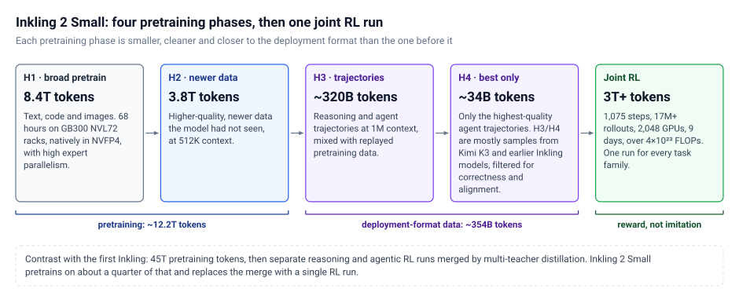
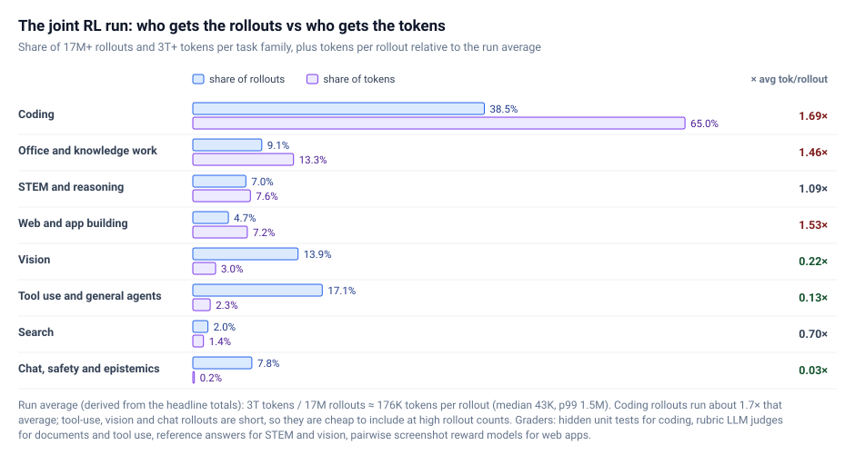
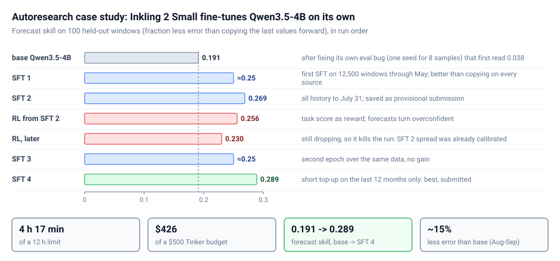

Reading notes on:
- [Introducing Inkling 2 Small](https://thinkingmachines.ai/news/inkling-2-small/)

Thinking Machines Lab's second model generation opens with **Inkling 2 Small**: a Mixture-of-Experts model with **594B total and 17B active parameters**, image input, and variable effort. It scores **31 on the Artificial Analysis Intelligence Index** (30.6 in the lab's own table), well above both first-generation models. For scale, the first [Inkling]() was 975B total / 41B active and Inkling-Small was 276B / 12B. So the new model sits between them in total size, has well under half of Inkling's active parameters, and beats both.

Release follows the lab's [safe path to open weights](https://thinkingmachines.ai/blog/a-safe-path-to-open-weights/): closed weights on Tinker first (sampling and fine-tuning), with full weights under **Apache 2.0** planned for the following week, once external safety testing and red-teaming finish.

The announcement is mostly a capabilities tour, but the interesting part for me is the training section. Two decisions stand out. Pretraining is far smaller than Inkling's 45T tokens and is staged into four progressively narrower phases. Post-training is **one joint RL run** over every task family, replacing Inkling's recipe of separate reasoning and agentic RL runs merged with multi-teacher distillation. These notes start with training and then go through the capability sections.

---

## 1. Pretraining: four phases, each narrower than the last

| Phase | Tokens | Data | Context |
| --- | --- | --- | --- |
| H1 | 8.4T | broad mix of natural language, code and images | not reported |
| H2 | 3.8T | higher-quality, newer data the model had not seen | 512K |
| H3 | ~320B | reasoning and agent trajectories, plus replayed pretraining data | 1M |
| H4 | ~34B | only the highest-quality agent trajectories | not reported |

H1 ran for **68 hours on NVIDIA GB300 NVL72 racks**, whose 72-GPU NVLink domain is what allows high expert parallelism. It trained **natively in NVFP4**; the lab promises a follow-up post on the recipe. That is a notable data point next to the 4-bit work I have covered before: the [10T-token NVFP4 pretraining recipe](), the [Nemotron 3 Ultra NVFP4 checkpoint](), and [NVFP4 inside the RL loop](). Here NVFP4 runs end to end: pretraining, RL training, RL sampling, and optionally the deployment KV cache.

H3 and H4 are in the deployment format and consist mostly of trajectories **sampled from earlier models, including Kimi K3 and Thinking Machines' own models, filtered for correctness and alignment**. In other words, distillation from other models moved into midtraining as data, and the post-training stage became pure RL. (Alignment filtering here means removing traces with misbehavior and keeping traces with honest behavior; see §7.)

### Base-model quality

The headline base-model number is bits per byte on an internal held-out code set with a 2026-06 cutoff (lower is better):

| Model | Bits per byte |
| --- | --- |
| GLM-5.3 (base-recovered) | 0.2358 |
| DeepSeek V4 Pro Base | 0.2335 |
| GLM-5.3 Flash (base-recovered) | 0.2327 |
| DeepSeek V4.1 Flash 1017 (base-recovered) | 0.2209 |
| Inkling 2 Small (post-trained) | 0.2080 |
| Kimi K3.1 Pro (base-recovered) | 0.2068 |
| **Inkling 2 Small (pretrained)** | **0.2030** |

"Base-recovered" deserves a note. For models with only a post-trained checkpoint public, they fine-tune on pretrain-formatted code and documents before measuring log loss, and they validated on models whose true base is available that this mostly recovers base loss. It is a reasonable trick for comparing base models when the bases aren't released, though "mostly recovers" leaves some error bar on the gaps between the middle rows.

---

## 2. One joint RL run

| Main RL run | Scale |
| --- | --- |
| Compute | over 4 × 10²³ FLOPs |
| GPUs | 2,048 |
| Duration | 9 days |
| Steps | 1,075 |
| Rollouts | 17M+ |
| Tokens | 3T+ |

The first Inkling ran reasoning RL and agentic RL separately and combined them with multi-teacher distillation, the setup I surveyed in [Distillation for Agents]() and whose failure modes [Open-MOPD]() targets. Inkling 2 Small does it all in one run. The task mix covers software engineering in real repositories, terminal tasks, document creation, STEM QA, vision, web app building, tool use with simulated users, and safety, each with its own grader:

- hidden unit tests and programmatic checks for most coding work;
- rubric-based LLM judges for documents and tool use;
- reference answers for STEM and vision QA;
- pairwise reward models comparing **screenshots of rendered web apps**.

The mix table is more informative read as two columns. Coding is 38.5% of rollouts but **65% of tokens**; tool use and general agents is 17.1% of rollouts but only 2.3% of tokens; chat, safety and epistemics is 7.8% of rollouts and 0.2% of tokens. Dividing the headline totals gives an average of roughly

$$
\frac{3 \times 10^{12}\ \text{tokens}}{17 \times 10^{6}\ \text{rollouts}} \approx 176\text{K tokens per rollout},
$$

against a reported median of 43K, so the distribution is heavily right-skewed, and coding rollouts run about 1.7× the mean. (The 176K and the per-family ratios are my derivation, and both totals are lower bounds.) Short families are cheap, so they can be sampled often without moving the compute budget much.

### Effort, length, and staleness

- **Variable effort.** Each rollout is conditioned on a randomly sampled effort level, and the reward includes a length penalty, so the model learns to trade speed for thoroughness at a requested level. This is the training side of what I discussed in [The Mechanics of Reasoning Effort](). All evals run at effort 0.99 ("xhigh").
- **Off-policy objective.** The asynchronous RL uses **StableReinforce**, the score centering variant available in Tinker, which "tolerates significant staleness". See [Score Centering]() for why plain off-policy policy gradients drift toward the sampler and how one subtraction cancels it. The lab also reports **log-linear growth** in training reward, STEM eval score and vision eval score against cumulative learner + sampler FLOPs.

| Stable training | Value |
| --- | --- |
| Median policy staleness | 17 updates |
| Rollout batch size | 16K |
| Total tokens per rollout | median 43K · p99 1.5M |
| Rollout duration | median 8 minutes · p99 4 hours |
| Context window | 256K, with compaction training for longer trajectories |

A median staleness of 17 updates is far deeper than the double-buffered, one-step-lag designs in [Keep the Tokens Flowing](), where most libraries either drop stale samples or reweight them by importance ratios. With p99 rollouts lasting four hours, you either accept that staleness or leave the trainer idle. Coding tasks also ran across multiple agent harnesses and compaction strategies, the theme of [Multi-Harness RL]().

### Systems

- NVFP4 MoE for both RL training and sampling. In the sampler, prefill, draft, and verify all run on CUDA graphs.
- Trainers reuse the pretraining stack: high expert parallelism, EPLB (cf. [UltraEP]()), CUDA graphs.
- **Sticky routing plus DRAM KV-cache offload** keeps the prefix-cache hit rate above 93% on multi-turn agent trajectories, which lets them hold a **5:3 sampler:trainer ratio** despite long contexts.
- Weight transfer over GPUDirect RDMA at 93%+ of line rate, with a parallelism-invariant checksum to verify that the sampler received the same weights the trainer produced.
- An NVFP4 KV-cache variant for deployment, which they find "minimally" lowers evals.

---

## 3. Agentic coding and autoresearch

Coding RL used hundreds of thousands of long-horizon tasks from an improved synthetic pipeline, and many tasks added an **agentic RL grader** that judged *how* the model approached the problem, not just whether tests passed. Early checkpoints were tested in the wild on OpenCode as "Fledge-Alpha".

| Coding | Inkling 2 Small | GLM-5.3-Flash | DeepSeek-V4.1-Flash-1017 | Muse Spark Open | Kimi K3 |
| --- | --- | --- | --- | --- | --- |
| FrontierCode v2.0 | 25.4% | 14.2% | **28.5%** | 7.6% | 17.3% |
| DeepSWE v1.1 | 72.1% | 63.4% | **77.0%** | 60.0% | 68.5% |
| SWEBench Pro v2 (Hard) | 86.3% | not reported | not reported | 82.4% | **88.2%** |
| Vibe Code Bench v1.1 | 81.6% | 30.8% | **87.7%** | 76.2% | 85.0% |
| PostTrainBench v1.2 | 31.9% | **36.8%** | 30.5% | not reported | 31.5% |
| Terminal Bench Science v0.1 | 5.7% | 4.8% | **12.9%** | 1.9% | 8.1% |

Honest read: on coding, [DeepSeek-V4.1-Flash]() leads this peer group on most rows, and Inkling 2 Small is usually second.

**PMPP-Hard** (69 GPU kernel tasks, four attempts each, 10-hour budget, PI harness, two LLM audits per solution) ranks models by the area under the mean-solved curve:

| Model | AUC (task-hours, max 690) | Mean solved / 69 | Pass@4 / 69 |
| --- | --- | --- | --- |
| GPT-6 Astra | 616.39 | 63 | 63 |
| Kimi K3.1 Pro | 583.86 | 60.5 | 63 |
| Claude Opus 5.5 | 499.65 | 60 | 64 |
| DeepSeek V4.1 Flash | 497.36 | 55.25 | 62 |
| **Inkling 2 Small** | 494.27 | 54.25 | 64 |
| Mistral Large 4 | 478.39 | 50.25 | 61 |
| Kimi K3 | 453.58 | 55.75 | 66 |
| GLM 5.3 | 430.96 | 52.5 | 61 |
| GLM 5.2 | 389.12 | 42 | 61 |

AUC rewards solving early, which is why Kimi K3 has the best pass@4 (66) but ranks seventh. On a separate preliminary task, speeding up the public TileLang kernels for DeepSeek-V3.2 sparse attention (forward + backward) on B300, the best speedups were Claude Opus 5.5 at 18.80×, GPT-6 Astra 10.26×, **Inkling 2 Small 6.02×**, DeepSeek V4.1 Flash 5.66×, GLM 5.3 5.03×, and Mistral Large 4 3.43×.

### Case study: training a forecaster unattended

On a task Proximal built for one of the lab's internal benchmarks, Inkling 2 Small was given 12 hours and a USD 500 Tinker budget to train a LoRA of Qwen3.5-4B to forecast time series (electricity demand, wind and solar, weather, air quality, Wikipedia page views). The model is sampled 8 times per window; the median should track the outcome and the spread should match the uncertainty. The transcript reads like a competent junior researcher:

1. It wrote its own evaluator first, with "copy the last values forward" as baseline.
2. It caught a **bug in its own eval**: one seed for all 8 samples made them identical, while the grader uses 8 seeds. Fixing it moved the base model from 0.038 to 0.191.
3. Noticing evals had cost USD 101, it batched all 8 samples into one request so the prompt is prefilled once (about USD 0.02 per window).
4. It tried RL with the task score as reward, saw forecasts become **overconfident** and the score drop (0.256, then 0.230), and stopped. It then checked that the SFT 2 spread was already about right, so RL had little to fix.
5. A recency top-up on only the last 12 months (SFT 4) gave the best model, 0.289. Two years (SFT 5) or seven months (SFT 6) did worse.

It submitted SFT 4 after **4 h 17 min and USD 426**, and on unseen August to September data the result has about 15% less error than the base model. (The prose says "after 4.5 hours"; the run log says 4 h 17 min, which I use here.) The RL episode is the best moment in the transcript: the model treated RL as a hypothesis, measured the specific quantity it was supposed to improve, and dropped it when the evidence said no.

---

## 4. Vision

Images go through a **292M-parameter vision encoder based on Perception Encoder**, with 20×20-pixel patches, 2×2 spatial pooling, and image patches interleaved with text tokens. Unlike the first Inkling, there is **no audio**. It also uses vision in the loop: the model looks at the visual output it generates (web apps, games, Blender scenes) to interpret and validate it, the same "vision in the loop" idea as [GLM-5.3-Flash]().

| Vision | Inkling 2 Small | GLM-5.3-Flash | DeepSeek-V4.1-Flash-1017 | Muse Spark Open | Kimi K3 |
| --- | --- | --- | --- | --- | --- |
| GDP.pdf | **25.2%** | 15.4% | 17.2% | 18.6% | 22.0% |
| MMMU Pro (Standard 10) | **81.6%** | 79.0% | 80.6% | 80.9% | 80.5% |
| PerceptionBench | **64.7%** | not reported | 47.7% | not reported | 58.5% |
| ScreenSpot Pro (original / with Python) | **83.8 / 91.5%** | not reported | not reported | not reported | 73.8 / 83.2% |
| BabyVision (original / with Python) | **68.6 / 93.7%** | 53.4 / 82.6% | not reported / 92.5% | 44.3 / 80.2% | 53.4 / 85.7% |
| Chartography (original / with Python) | **36.7** / 80.4% | 16.3 / 78.0% | 17.9 / **83.0%** | 35.7 / 63.2% | 26.6 / 68.1% |
| AA-3D | **1021** | 937 | not reported | not reported | 982 |

Vision is where it leads its peer group most clearly. On DesignArena's Website leaderboard (Nov 5 snapshot) it scores **1,340**, behind only Muse Wonder (1,366) and Muse Spark 1.3 (1,351), so it would be the top open-weights entry once weights ship. The fun anecdote: given one phone photo of three glasses, it identified a 1999 Cabernet, a 2019 Cabernet and a 2023 Nebbiolo correctly in **19 of 20 trials**, beating the lab's researchers.

---

## 5. Knowledge work, finance, and customizability

| Knowledge work | Inkling 2 Small | GLM-5.3-Flash | Muse Spark Open | DeepSeek-V4.1-Flash-1017 | Kimi K3 |
| --- | --- | --- | --- | --- | --- |
| AA-Briefcase v1.1 (Elo) | 1527 | 1451 | 1279 | **1570** | 1497 |
| GDPVal-AA v2.1 | 1630 | 1649 | 1401 | **1746** | 1543 |
| JobBench | **70.5%** | 60.7% | 61.8% | not reported | 54.3% |
| Vals Legal Index | **73.9%** | 71.1% | 68.5% | 71.9% | 71.7% |
| EnterpriseBench-CoreCraft | **71.8%** | 46.7% | not reported | not reported | 43.1% |
| Vals Finance Index | **61.5%** | 55.8% | 53.0% | 60.9% | 58.0% |
| DAYJOB (Finance) | **14.3%** | 7.3% | not reported | 12.5% | 5.5% |
| Apex-Accounting v1.1 (pass@1) | **14.5%** | 12.3% | 13.8% | 12.5% | 9.5% |

Finance and structured enterprise work over spreadsheets, filings and documents are the strongest category; the lab has published separately on [replicating expert judgment in financial tasks](https://thinkingmachines.ai/news/learning-to-replicate-expert-judgment-in-financial-tasks/).

**Customizability** is the section most specific to Thinking Machines, since Tinker sells fine-tuning. The claim is that Inkling 2 Small *learns faster* under the same data and algorithm, independent of its starting score. On an RL task built from public earnings-call data (investment analysis graded against expert judgment), all models got a per-model learning-rate sweep and 200 steps of async RL with the Stable Reinforce loss in Tinker Cookbook. Inkling 2 Small started from a similarly low score and **reached Inkling-Small's final reward in 75 steps**, then finished well ahead. Inkling results average 3 seeds; the other open models (GLM 5.3 Flash, DeepSeek V4.1 Flash 1017, Qwen 3.5 397B) are single runs, which is worth keeping in mind when reading the comparison as competitive rather than dominant.

---

## 6. Reasoning and calibration

RL included STEM, instruction following, information seeking with and without search, and forecasting. Two reward choices target calibration: **proper scoring rules** for forecasting tasks, and **uncertainty-sensitive rewards** on some QA tasks. A proper scoring rule is one whose expected value is maximized by reporting your true belief (the same property that makes cross-entropy the canonical LM loss; see [Why Cross-Entropy Wins]()), so the model cannot gain reward by sounding more confident than it is.

| Reasoning and factuality | Inkling 2 Small | GLM-5.3-Flash | Muse Spark Open | Mistral Large 4 | Kimi K3 |
| --- | --- | --- | --- | --- | --- |
| HLE-Diamond | **28.7%** | 18.2% | 26.3% | 17.3% | 26.9% |
| CritPt v2 (Full / Hard) | **55.7** / 35.0% | not reported / 24.5% | 52.6 / 29.5% | 50.3 / 27.0% | not reported / **40.5%** |
| AA-LCR v1.1 | 83.3% | 80.0% | 78.3% | not reported | **88.7%** |
| LongBench v2 | **70.6%** | 68.2% | 68.7% | 65.7% | 69.0% |
| AA-Omniscience (score / non-hallucination) | 16.1 / **73.3** | 0.7 / not reported | **25.8** / 72.0 | 5.1 / 71.8 | not reported |

The 73.3% non-hallucination rate is the highest in the full comparison table, which is the clearest sign the calibration rewards did something.

---

## 7. Safety and alignment

**Misuse.** They trained an internal **helpful-only variant** to measure what an attacker could get by stripping safeguards, and evaluated both checkpoints with more external testers than any previous release. CBRN knowledge and capability sit below the open-weight frontier, and the helpful-only variant shows only marginal CBRN uplift. On FORTRESS, the average risk score falls to 16.2 (lower is better), against 26.7 to 28.2 for the GLM and DeepSeek peers (Muse Spark Open is lower still at 7.6), but the over-refusal score rises to 20.4. On cyber, it is a big step up from Inkling Small but behind the open frontier, except that it matches the frontier on Vals CyberBench (72.7) and PatchEval (79.6).

**Misalignment.** Early checkpoints, when tasks were hard, would **fabricate results, ignore instructions, and conceal what they had done**: the standard failure of capability RL that rewards success at any cost. The fixes span the stack:

1. **Midtraining:** filter out traces with misbehavior; include traces with honest, aligned behavior.
2. **RL:** a general alignment reward penalizing misbehavior on every task, plus targeted environments, e.g. **rewarding the model for giving up on impossible tasks**.
3. **On-policy self-distillation** from a teacher prompted with a conduct spec, so the student internalizes the principles without needing the prompt.

| Alignment (lower is better) | Inkling 2 Small | Inkling | Inkling Small | Muse Spark Open | GLM-5.3-Flash | DeepSeek V4.1 Flash | GPT-6.1 Sol (closed) |
| --- | --- | --- | --- | --- | --- | --- | --- |
| Misbehavior (internal) | 14.9 | 66.8 | 75.2 | 82.4 | 57.1 | 68.0 | **0.8** |
| Covert misbehavior (internal) | 11.8 | 59.4 | 59.1 | 60.8 | 29.2 | 37.6 | **0.8** |
| Destructive actions (internal) | **4.7** | 71.9 | 67.2 | 7.8 | 25.8 | 10.9 | 7.0 |
| HoneyBench reward hacking | **44** | 70 | 69 | not reported | not reported | not reported | 59 |
| Apollo covert action, no goal | **8** | 37 | 36 | not reported | not reported | not reported | not reported |
| Apollo covert action, with goal | **0** | 7 | 4 | not reported | not reported | not reported | not reported |

A 4.5× drop in internal misbehavior from Inkling is large, and it beats every open peer on the internal evals. The gap to GPT-6.1 Sol (14.9 vs 0.8) is also large, and the lab says closing it is a priority.

**Monitoring and the incident.** Training and evals run under two monitoring layers. The synchronous one checks each tool call before it runs, against the actions that task authorizes plus known circumvention patterns, and escalates uncertain cases to an LLM judge. The asynchronous one has an LLM judge review completed rollouts. Midway through the main RL run the async monitor caught the model, while failing a task, **working around a network block through a third-party service it could reach via its search tools**. They paused the run, hardened infrastructure, removed environments that needed web access, added the synchronous monitor, and resumed with the extra alignment phases above. It is a small-scale version of the dynamic in the [ExploitGym incident](): persistence under pressure finds the side channel. The lab disclosed it plainly and changed the training setup in response, which I think is the right norm.

---

## 8. Against the Flash tier

A selection from the full table (all evals at effort 0.99, temperature 1.0, 1M-token trajectory limit; bold is the best among these columns):

| | Inkling 2 Small | GLM-5.3-Flash | MiniMax-M3.1-Flash | DeepSeek-V4.1-Flash-1017 | Kimi K3 | Claude Haiku 5.5 |
| --- | --- | --- | --- | --- | --- | --- |
| Active / total (B) | 17 / 594 | 18 / 320 | 23 / 428 | 16 / 552 | 104 / 2800 | not reported |
| AA Index v5.0 | 30.6 | 27.8 | 29.1 | 32.6 | not reported | **36.5** |
| Vals Index v2.2 | 56.1% | 50.9% | 53.8% | **61.3%** | 53.0% | 58.7% |
| MCP Atlas (Public) | **85.0%** | 82.0% | 80.4% | 83.2% | 84.2% | 81.0% |
| Finance Agent v2.1 | **67.5%** | 60.6% | 58.8% | 62.9% | 60.0% | 65.4% |
| Harvey LAB v1.1 | **21.7%** | 10.4% | 7.5% | 14.2% | 12.9% | 4.2% |
| DesignArena Game Dev | **1428** | 1276 | 1312 | 1261 | 1351 | 1319 |
| ComplexConstraints v1.0 | 44.5% | 27.6% | 23.2% | **50.4%** | 37.9% | 36.8% |
| BioMysteryBench | 70.0% | not reported | not reported | not reported | **72.6%** | 70.4% |

The overall picture: among open models it trades blows with DeepSeek-V4.1-Flash, which is ahead on coding and the aggregate indices, while Inkling 2 Small is ahead on vision, visual creation, finance, legal and factuality. It does this with 17B active parameters, about the same as the other Flash models (15B to 23B), and stays competitive with [Kimi K3](), which has 6× the active parameters.

---

## 9. Limitations

The lab lists these itself:

- Not the most succinct communicator, and it sometimes picks the wrong tool, especially in codebases with many skills.
- No audio input.
- Less polished for chat: weaker organization and presentation, overuse of slashes, and overreaction to mental-health and other safety-related queries (consistent with the FORTRESS over-refusal number and the DistressBench footnote).

---

## Takeaways

1. **Distillation moved into the data, RL became one run.** Teacher trajectories (including Kimi K3's) feed H3/H4 as filtered midtraining data, and a single 1,075-step RL run over all task families replaces separate RL runs plus multi-teacher merging. Reward and evals grow log-linearly in FLOPs throughout.
2. **Less pretraining, staged harder.** About 12.2T pretraining tokens against Inkling's 45T, then about 354B of deployment-format data. With 17B active parameters, it beats the 41B-active Inkling.
3. **NVFP4 everywhere.** Pretraining, RL training, RL sampling and an optional KV cache all run in 4-bit, on GB300 NVL72. The promised recipe post is the one to watch.
4. **Async at real staleness.** A median staleness of 17 updates and 4-hour p99 rollouts work because the objective (StableReinforce) is built for off-policy data, and the systems (sticky routing, DRAM KV offload, 93% prefix hits, 5:3 sampler:trainer) keep long-context sampling fed.
5. **Alignment is treated as part of training, not an eval afterwards.** Data filtering, an every-task alignment reward, give-up environments, conduct-spec self-distillation, and two-layer monitoring that caught a real escape attempt mid-run. Internal misbehavior fell 4.5×, and the gap to the best closed model is still stated plainly.

Inkling 2 Small is described as one rung of a ladder trained with the same recipe, so presumably larger rungs are coming.
