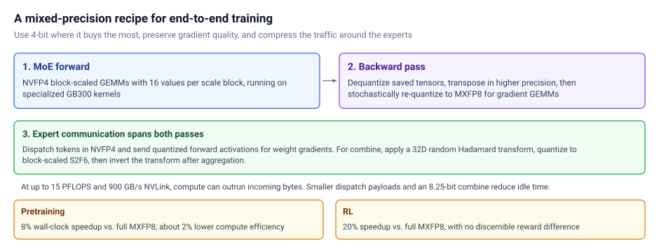

Reading notes on:
- [End-to-End 4-Bit Training](https://thinkingmachines.ai/blog/end-to-end-4-bit-training/)

Thinking Machines Lab describes **Inkling 2 Small** as the largest model it knows of trained with a native 4-bit forward pass. It uses the same numerical recipe from pretraining through supervised fine-tuning and reinforcement learning. The recipe is deliberately mixed precision: use NVFP4 for MoE forward computation, use MXFP8 for backward computation, and quantize expert-parallel communication so the faster matrix multiplies do not leave the GPUs waiting for data. The lab reports an **8% wall-clock speedup in pretraining** and **20% in RL** over full MXFP8 training.

This extends the results in [the 10-trillion-token NVFP4 pretraining work]() and [NVFP4 inside the RL loop](). The emphasis here is the whole MoE training path: the forward and backward passes use different formats, and the communication path gets its own quantization recipe. It is the numerical recipe behind the 68-hour Inkling 2 Small pretraining run in my [model notes]().

---

## 1. Spend precision where it matters

On NVIDIA's GB300, the peak matrix-multiply throughput reported for NVFP4 is **15 PFLOPS**, compared with **5 PFLOPS for MXFP8** and **2.5 PFLOPS for BF16**. The storage cost includes scale factors, so NVFP4 averages 4.5 bits per value and MXFP8 averages 8.25:

| Format | Bits per value, including scales | GB300 peak matrix throughput |
| --- | ---: | ---: |
| NVFP4 | 4.5 | 15 PFLOPS |
| MXFP8 | 8.25 | 5 PFLOPS |
| BF16 | 16 | 2.5 PFLOPS |

The MoE expert layers are an attractive place to use the narrow format: they account for substantial computation, and the lab found quantizing them harmed accuracy less than quantizing other layers. But applying NVFP4 indiscriminately caused an unacceptable compute-efficiency loss. The key ablation was that **NVFP4 in the forward pass gave a better speed and accuracy tradeoff than also using it in the backward pass**.

The distinction is important. Pretraining forward and RL sampling run at enormous volume, so throughput and memory traffic matter most there. Backward passes average over many tokens, which tends to cancel random rounding error, but they are vulnerable to **bias**: a small directional rounding error can accumulate through layers and optimization steps. The recipe keeps the fast low-bit forward computation while avoiding a biased, mismatched backward pass.

---

## 2. NVFP4 uses local scales to fit the data

The four-bit E2M1 format has **16 encodings**, representing signed zero and signed magnitudes 0.5, 1, 1.5, 2, 3, 4 and 6. NVFP4 gets useful dynamic range by scaling each group of **16 consecutive values** according to the largest magnitude in that block. Each block scale uses E4M3, an 8-bit floating-point format with more precision than the power-of-two E8M0 scales used by MX formats.

For example, a block maximum of 54 can be represented as 6 with a block scale of 9. A tensor-level FP32 outer scale then shifts the range for the whole tensor. The value reconstructed from its three parts is:

$$
x_i = x_i^{\text{FP4}} \times x_{i // 16}^{\text{FP8}} \times x^{\text{FP32}}.
$$

The small block size is especially useful when neighboring values have different magnitudes. It also creates a transpose problem for backward computation. A forward pass groups values in rows; a matrix multiply in the backward pass can group those same values in columns. The new groups have different maxima and therefore different scales. A large value can force small neighbors to round to zero.

Using one scale for a whole 16-by-16 tile would keep the forward and transposed representations identical, but it is too coarse. With one outlier in the tile, the lab's example retains only the outlier; the other 255 values round to zero. The design needs the finer 1-by-16 blocks without letting the change in grouping introduce a directional error.

---

## 3. Re-quantize for backward with stochastic rounding

The solution is to recover the quantized forward values, transpose them in higher precision, and then re-quantize them for the backward pass. Instead of rounding to the nearest representable value every time, the re-quantization uses **stochastic rounding**: it randomly chooses between adjacent values with probabilities that preserve the input in expectation. This is the same bias-control idea covered in my notes on [stochastic rounding]().

Take a forward value of 5.4 in a block with scale 9. NVFP4 represents it as 0.5 times 9, or 4.5. After transposition, suppose its new scale is 2. Dividing 4.5 by 2 gives 2.25, between the representable values 2 and 3. Deterministic rounding chooses 2, reconstructing 4. Stochastic rounding chooses 2 three-quarters of the time and 3 one-quarter of the time:

$$
2 \times (0.75 \times 2 + 0.25 \times 3) = 4.5.
$$

The expected value is preserved even though the backward block differs. Thinking Machines re-quantizes the saved weights and activations to **MXFP8** and computes the gradients with MXFP8 matrix multiplies. This gives the backward pass more precision than NVFP4 while retaining a faster, more compact representation than BF16.

The lab also uses its [Four Over Six quantizer]() for activations, selecting between two possible scales to reduce NVFP4 error. It does not use Four Over Six for weights. The last **16.6% of layers** stay in MXFP8, and the outer scales are per expert for weights and per token for activations. Those choices keep activation scaling batch-invariant and avoid letting future tokens influence a scale.

---

## 4. Faster compute makes communication the next bottleneck

An MoE layer routes tokens to experts that may live on different GPUs. The GPUs first exchange tokens for dispatch, compute the expert functions, then exchange outputs to combine them. On a GB300 NVL72 system, NVLink provides **900 GB/s in each direction**, while NVFP4 matrix multiplies can reach **15 PFLOPS**. At that ratio, a GPU can perform roughly **16,000 floating-point operations while one byte arrives**. If each byte does not bring enough work, the compute units wait on communication.

The recipe reduces traffic at each stage:

- **Dispatch:** send tokens in NVFP4.
- **Weight-gradient inputs:** use quantized forward activations instead of sending high-precision copies.
- **Combine:** rotate each 32-value vector with a random Hadamard transform, then quantize it to block-scaled S2F6.

The Hadamard transform spreads outliers across the vector while preserving its total energy. That makes the values easier to represent with S2F6, a fixed-point 8-bit format. The output is de-quantized and aggregated as it arrives, then the transform is inverted. This reduces the combine payload from 16 bits to **8.25 bits per value**, including scale overhead. The lab reports no measurable training-accuracy degradation from this transform-plus-quantize step. Plain MXFP8 combine performed worse because its format handled outliers less well.

---

## 5. Kernels have to keep every pipeline busy

Low precision shifts work onto the GPU's arithmetic logic units (ALUs): scale calculation, weight re-quantization, stochastic rounding and data packing all compete with the matrix multiplications. Thinking Machines built its MoE kernel stack, **BBBK** (Big Beautiful Blackwell Kernel), to keep Tensor Cores, ALUs and NVLink active together. It fuses the Hadamard transform and S2F6 conversion into the expert GEMM epilogue, and uses vectorization, instruction scheduling and register planning to limit stalls.

Across its largest jobs, the recipe produces an **8% end-to-end pretraining speedup** over full MXFP8, while costing about **2% in compute efficiency**. In RL, the end-to-end gain is **20% with no discernible reward difference**. The same numerical configuration spans pretraining, SFT and RL, so the final model does not need a separate post-training calibration step to match the quantized training format.

The engineering lesson is that 4-bit training is a stack decision. The format itself is only one part: block shape determines what survives quantization, the backward pass must manage transposition and bias, communication has to keep up with compute, and kernels must schedule the extra quantization work efficiently. NVFP4 pays off when these choices are designed together.
