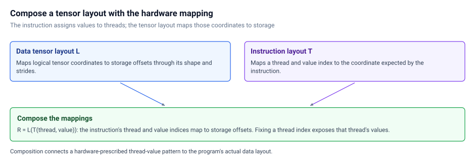

Reading notes on:
- [CuTe Layout Representation and Algebra](https://arxiv.org/pdf/2603.02298)

CuTe starts from a practical observation: a tensor algorithm needs to know where each logical element lives and how an instruction expects its values to be arranged. On modern GPUs, tensor cores and asynchronous copy instructions impose layouts that affect both correctness and speed. CuTe makes those mappings explicit, then provides algebra for transforming them.

The paper formalizes the layout model behind CUTLASS and CuTe DSL. It explains the mathematical idea behind the CuTe DSL examples in [FlashAttention-4]() and [CODA]().

---

## 1. A loop nest is a shape and a stride

A conventional loop nest already contains the ingredients of a layout. After converting loop variables to zero-based indices, the loop bounds form a shape and the address increments form strides. For outer address strides $p$ and $q$, the paper's example can be written as:

```text
for j in 0..19:
    for i in 0..3:
        A[4p + 3q + 5p*i + 2q*j] = f(i, j)
```

Its iteration space has shape $(4,20)$ and stride $(5p,2q)$. The accessor begins at `A + 4p + 3q`; the layout maps each loop coordinate to its offset from that base. This makes loop transformations into layout transformations: split or combine indices, permute modes, select a tile, or change an access pattern by transforming the mapping rather than rewriting each algorithm around a new data arrangement.

CuTe makes the coordinate space hierarchical. In the example, the two-dimensional coordinate $(i,j)$ can also be viewed as a single coordinate $k$ from 0 through 79:

$$
(i,j) = (k \bmod 4, \lfloor k/4 \rfloor).
$$

The nesting lets generic code work with a flattened view or with the original modes, while preserving the same elements. This is one reason CuTe algorithms can be rank-agnostic: the algorithm can state the shape it requires without hard-coding how that shape is divided into tensor modes.

---

## 2. A layout is a mapping, not just metadata

For a flat shape and stride, a layout maps coordinate $c$ to an offset. If the shape is $S$ and the stride is $D$, then in the ordinary integer-stride case:

$$
L(c) = \sum_i D_i c_i.
$$

A tensor combines this mapping with an accessor, usually a pointer. Evaluating the tensor at coordinate $c$ applies the layout to get an offset, then reads through the accessor. CuTe keeps the shape and stride hierarchical, so the same idea can express nested, padded, interleaved, or swizzled arrangements. Layouts can also describe mappings whose outputs are coordinates or other structured values, not only scalar memory offsets.

This is useful when an instruction prescribes which thread owns each value. The paper works through an Ampere FP64 Tensor Core accumulator example: a thread-value layout maps 32 threads, each with two values, onto coordinates in an 8-by-8 result. The layout is instruction metadata. Composing it with the data tensor layout converts the instruction's thread and value indices into offsets in the actual tensor:



In PyCuTe-style pseudocode, the operation is:

```python
smem_tv = composition(smem_data, tv_layout)
smem_v = smem_tv[thr_id, None]
```

The first line composes the memory layout with the instruction layout. The second fixes a thread index and exposes the values assigned to that thread. The algorithm can therefore keep the instruction's ownership pattern separate from whether the underlying tensor is row-major, column-major, padded, interleaved, or swizzled. This is the kind of layout pressure that appears in [Blackwell's TMA and Tensor Core paths]().

---

## 3. Layout algebra builds transformations

CuTe defines operations over layouts so programmers and compilers can derive new mappings from existing ones.

| Operation | What it does |
| --- | --- |
| Concatenate | Builds a larger hierarchical layout from sublayouts. |
| Coalesce | Simplifies compatible modes while preserving the layout's mapping. |
| Composition | Feeds coordinates through one layout and then another, enabling reshapes, permutations, partitions, and tiles. |
| Complement and logical divide | Complete a selected tile with the remaining coordinates, then split a layout into tile and grid modes. |
| Right inverse | Finds coordinates associated with offsets, which helps identify common contiguous subvectors and safe vector copy widths. |

For composition, if $A$ maps coordinates to offsets and $B$ maps thread-value pairs to coordinates, then the result applies $B$ first and $A$ second:

$$
R(c) = A(B(c)).
$$

Tiling uses the same idea. A tiler describes the sublayout to extract; a complement accounts for the rest of the tensor. A logical divide combines them into tile and grid modes, after which a block index selects one tile. Right inverses help answer a different performance question: which adjacent offsets can source and destination layouts share, and how wide can one copy instruction be? The paper derives these opportunities from layout algebra, with pointer alignment and hardware limits added as constraints.

---

## 4. One algorithm can support many layouts

The paper uses two generic primitives to show what the representation buys.

- **COPY** iterates over a logical index and reads from one tensor layout into another. The same algorithm can cover arrays of different ranks, transposes, gathers, scatters, and broadcasts, as long as the source and destination have compatible sizes.
- **GEMM** works over logical row, column, and reduction coordinates. Layouts express the usual transposed and strided matrix variants, folded tensor contractions, and convolution through an `im2col` mapping.

In the paper's comparison, CUTLASS v2 had nearly 300 individually implemented layouts spread over 87 files, totaling about 55,000 lines. The CuTe core representation and algebra take about 3,000 lines and can represent those layouts and more. These are the paper's code-size figures, not a measurement of engineering hours.

The paper also reports that CuTe is the foundation of CUTLASS v3 and v4, and that existing CUTLASS and FlashAttention evaluations show no performance overhead from the abstraction. Its main contribution here is a way to separate algorithm logic from data layout while still checking instruction-specific constraints. The generic examples explain the reuse; specialized kernels still need suitable tiling, memory movement, and scheduling.

---

## 5. The algebra has boundaries

CuTe is more expressive than a flat shape-stride pair, but it cannot represent every possible coordinate-to-offset function. Some compositions require shape and stride divisibility conditions. If the requested tile or sampling pattern does not divide the source layout in the required way, there is no valid result layout and the operation fails. The paper treats many such failures as useful compile-time errors: they can expose incompatible hardware requirements or a mistaken partition before the kernel runs.

That makes the framework's contract concrete. The user describes layouts and transformations; CuTe derives a result when the mapping is representable and rejects incompatible compositions. The author also provides [PyCuTe](https://github.com/NVlabs/CuTe), a pure-Python reference implementation for studying and checking the definitions.

---

## Takeaways

1. **A layout is an explicit coordinate mapping.** Shape and stride describe both ordinary arrays and the more complex arrangements required by GPU instructions.
2. **Algebra makes layout transformations reusable.** Composition, tiling, division, and inversion let generic algorithms derive thread ownership, subtiles, and vectorization opportunities from layout descriptions.
3. **Genericity depends on valid mappings.** Divisibility and compatibility constraints limit which transformations exist, and CuTe can check them at compile time.

CuTe's key move is to treat layouts as part of the program's mathematics. Once the mapping is explicit, a kernel can separate what it computes from how threads and memory represent its tensors.
